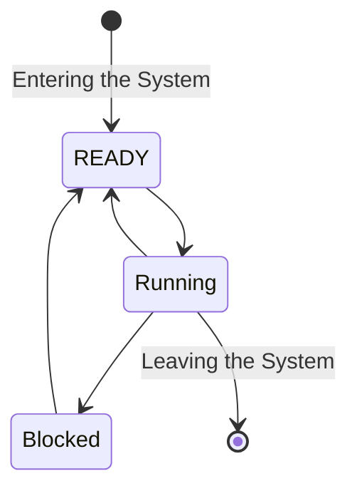

```text
x <- A + B
y <- A + B + C
```

Can be optimized to:

```text
x <- A + B
y <- x + C
```

### Scheduling Algorithms

An algorithm used to schedule many concurrent processes in a system.

**Brust Time:** The time required by a process to complete its task.

These include:
- Round robin
- Shortest job first
- First come first served
- Shortest remaining time

Shortest job first does what it says.

#### Round Robin:

Equal time slices, gives each process an equal number of run time, e.g, if we have processes:


| Process | Brust Time (ms) |
| ------- | --------------- |
| P1      | 10              |
| P2      | 15              |
| P3      | 7               |


Round robin with a time of 5ms per process.

$$
\begin{aligned}
&P_{1}-5 = 5 \\
&P_{2}-5 = 10 \\
&P_{3} -5 = 2 \\
& \\
&P_{1}-5=0 \\
&P_{2}-5=5 \\
&P_{3}-2=0 \\
& \\
&P_{2}-5=0
\end{aligned}

$$

#### Shortest remaining time

| Process | Brust Time | Arrival Time |
| ------- | ---------- | ------------ |
| P1      | 10         | 0            |
| P2      | 5          | 3            |
| P3<br>  | 3          | 7            |
| P4      | 15         | 10           |
...


### Process States


